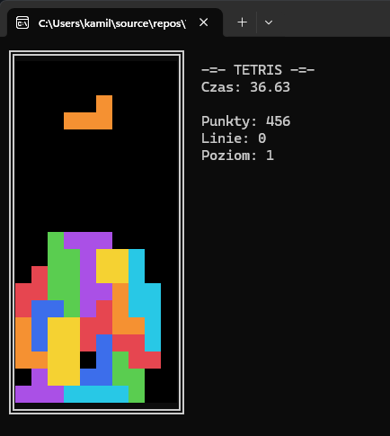

# Tetris w konsoli (C++)

Gra w stylu Tetrisa działająca w konsoli Windows, napisana w C++20 jako projekt zaliczeniowy z podstaw programowania obiektowego. Plansza i klocki są rysowane kolorowymi „pikselami” w terminalu za pomocą sekwencji ANSI.

## Funkcjonalność

- Plansza 10 × 20, siedem klasycznych klocków (I, O, T, S, Z, J, L) w kolorach zgodnych ze standardem Tetrisa.
- Losowanie klocków systemem „7-bag” — w każdej serii siedmiu klocków każdy kształt pojawia się dokładnie raz.
- Ruch w lewo i w prawo, obrót o 90° z korektą przy ścianie („wall kick”), zrzut na dół.
- Wykrywanie kolizji ze ścianami, dnem i leżącymi klockami.
- Usuwanie pełnych linii (także kilku naraz) i przesuwanie reszty planszy w dół.
- Punktacja, licznik linii, poziomy i rosnąca prędkość spadania.
- Statystyki z prawej strony planszy odświeżane automatycznie przy każdej zmianie wartości.
- Ekran powitalny z zasadami i podsumowanie po zakończeniu gry.

## Zasady gry

### Sterowanie

| Klawisz | Akcja |
|---|---|
| `A` / `←` | ruch w lewo |
| `D` / `→` | ruch w prawo |
| `W` / `↑` | obrót |
| `S` / `↓` | zrzut na dół |
| `Esc` | wyjście z gry |

### Punktacja

| Akcja | Punkty |
|---|---|
| 1 linia | 100 × poziom |
| 2 linie | 300 × poziom |
| 3 linie | 500 × poziom |
| 4 linie (Tetris) | 800 × poziom |
| zrzut na dół | 2 za każde pole |

Co 10 usuniętych linii poziom rośnie o 1, a klocki spadają szybciej. Czas spadku o jedno pole liczony jest oficjalnym wzorem Tetrisa: `(0.8 − (poziom − 1) · 0.007) ^ (poziom − 1)` sekund (minimum 0,05 s). Gra kończy się, gdy nowy klocek nie ma miejsca, żeby się pojawić.

## Wymagania

- Windows 10 (wersja 1703 lub nowsza) albo Windows 11 — wymagana obsługa kolorów 24-bitowych w konsoli.
- Do kompilacji: Visual Studio 2026 z obciążeniem „Programowanie aplikacji klasycznych w języku C++” (zestaw narzędzi MSVC v145, standard C++20).

## Kompilacja

### Visual Studio

1. Otwórz plik `Tetris.slnx`.
2. Na górnym pasku wybierz konfigurację **Release** i platformę **x64**.
3. Wybierz *Kompilacja → Kompiluj rozwiązanie* (`Ctrl+Shift+B`).

Plik wykonywalny pojawi się w `x64\Release\Tetris.exe`.

### Wiersz poleceń

W „Developer Command Prompt for VS” w folderze repozytorium:

```
msbuild Tetris.slnx /p:Configuration=Release /p:Platform=x64
```

Konfiguracja Release jest linkowana statycznie (`/MT`), więc gotowy `Tetris.exe` nie wymaga instalowania pakietu Visual C++ Redistributable — wystarczy sam plik. Kod źródłowy jest kompilowany z flagą `/utf-8`, bo zawiera polskie znaki w tekstach wyświetlanych w konsoli.

## Uruchomienie

- Uruchom `x64\Release\Tetris.exe` podwójnym kliknięciem albo z wiersza poleceń, albo
- w Visual Studio naciśnij `F5` / `Ctrl+F5`.

Gra musi działać w oknie konsoli. Jeśli wyjście zostanie przekierowane do pliku, program kończy się czytelnym komunikatem błędu (patrz przykłady niżej).

## Architektura

### Pliki i klasy

| Plik | Zawartość |
|---|---|
| `Tetris.cpp` | `main` i `RunGame` — pętla gry (~30 klatek/s), obsługa wejścia, ekran powitalny, podsumowanie, obsługa wyjątków |
| `Game.h/.cpp` | klasa `Game` — logika gry: ruch, obrót, kolizje, zamrażanie klocka, punkty, poziomy |
| `Board.h/.cpp` | klasa `Board` — stan planszy: każda kratka osobno, usuwanie pełnych linii |
| `Display.h/.cpp` | klasa `Display` — rysowanie w konsoli: ramka, kratki, klocki, tekst, ekran powitalny |
| `Stats.h/.cpp` | hierarchia statystyk: klasa bazowa `Stat` i pochodne `IntStat`, `FloatStat`, `TextStat` |
| `Pieces.h` | struktury `Piece` i `Color`, tablica 7 klocków, funkcja obrotu |
| `Action.h/.cpp` | `enum class Action` i odczyt klawiatury (WASD, strzałki, Esc) |

Schemat klas UML ze wszystkimi atrybutami, metodami i relacjami: [UMLschamat.md](UMLschamat.md).

### Relacje między obiektami

- `main` tworzy `Board`, `Display` i `Game`. `Game` i `Display` korzystają z tej samej planszy przez referencję (**agregacja**) — logika gry zapisuje do niej, a wyświetlacz tylko z niej czyta.
- `Game` zawiera statystyki `score_`, `lines_`, `level_` (`IntStat`) i aktualny klocek (`Piece`) jako pola (**kompozycja**) — żyją tak długo jak gra.
- `IntStat`, `FloatStat` i `TextStat` dziedziczą po abstrakcyjnej klasie `Stat` (**dziedziczenie**).

### Najważniejsze decyzje projektowe

- **Oddzielenie stanu od rysowania.** `Board` przechowuje zamrożone klocki (każda kratka ma wartość „typ klocka + 1”, 0 = puste), a `Display` tylko je wyświetla. Spadający klocek jest rysowany na wierzchu; gdy się przesuwa, miejsce pod nim jest odtwarzane z planszy (`Display::RestoreRect`), więc nie zamazuje leżących klocków. Konsola jest wolna, dlatego przerysowywane są tylko zmienione fragmenty, a nie cały ekran w każdej klatce.
- **Jedna funkcja kolizji.** `Game::CanPlace` sprawdza każdą zajętą kratkę klocka (granice planszy i zajętość pola). Każdy ruch i obrót najpierw sprawdza nową pozycję, a dopiero potem ją przyjmuje. Obrót przy ścianie próbuje przesunięć 0, −1, +1, −2, +2.
- **Usuwanie linii w jednym przejściu.** `Board::ClearFullRows` sprawdza tylko wiersze, w których wylądował klocek, i przesuwa niepełne wiersze w dół jednym przejściem z dołu do góry — działa tak samo dla 1 i dla 4 linii naraz.
- **Statystyki rysują się same.** Każdy obiekt `Stat` pamięta swój wiersz na ekranie i ostatnio wypisany tekst. Zmiana wartości (`=`, `+=`, `Set`, `Add`) od razu go przerysowuje, ale tylko wtedy, gdy tekst faktycznie się zmienił.

### Zastosowane mechanizmy programowania obiektowego

| Mechanizm | Gdzie |
|---|---|
| Klasy z atrybutami i metodami | `Game`, `Board`, `Display`, `Stat`, `IntStat`, `FloatStat`, `TextStat` |
| `private` / `public` / `protected` | wszystkie klasy; `protected` w `Stat` (`ValueText`, `Redraw`) |
| Konstruktory domyślne i parametryczne | `IntStat()` / `IntStat(display, row, label, value)` i analogicznie w `FloatStat`, `TextStat`, `Stat` |
| Enkapsulacja (gettery i settery) | `Board::Get/Set`, `IntStat::Get/Set/Add`, `Game::IsGameOver`, `Game::SetFallInterval` (pilnuje minimalnej wartości) |
| Operacje na obiektach | dodawanie kratek (`Board::Set`), usuwanie linii (`Board::ClearFullRows`), wyszukiwanie pełnych wierszy i wolnego miejsca (`IsRowFull`, `CanPlace`) |
| Dziedziczenie | `Stat` → `IntStat`, `FloatStat`, `TextStat` |
| Konstruktory klas pochodnych | `IntStat(...) : Stat(display, row, label)` |
| `virtual` / `override` | czysto wirtualna `Stat::ValueText()`, nadpisana w każdej klasie pochodnej; wirtualny destruktor `Stat` |
| Polimorfizm | `Stat::Redraw()` i `Stat::Text()` wołają `ValueText()` właściwej klasy; podsumowanie gry to pętla po `std::vector<const Stat*>` z obiektami różnych typów |
| Metody `const` | gettery, `Board::IsRowFull`, `Game::CanPlace`, `Stat::Text`, `ValueText` |
| Przeciążone operatory | `=` i `+=` w `IntStat`, `FloatStat` (`score_ += punkty`, `level_ = ...`, `time += dt`) oraz `=` w `TextStat` |
| Wyjątki | `Board` rzuca `std::invalid_argument` (zły rozmiar) i `std::out_of_range` (współrzędne poza planszą); `Display` rzuca `std::runtime_error`, gdy program nie działa w konsoli; `main` łapie `std::exception&` i wypisuje komunikat |

## Przykłady działania

### Ekran powitalny

```
   T E T R I S

   Układaj spadające klocki tak, aby tworzyły pełne poziome linie.
   Pełna linia znika, a Ty dostajesz punkty.

   STEROWANIE
     A / ←     ruch w lewo
     D / →     ruch w prawo
     W / ↑     obrót
     S / ↓     zrzut na dół
     Esc       wyjście

   PUNKTACJA (mnożona przez poziom)
     1 linia   100
     2 linie   300
     3 linie   500
     4 linie   800   TETRIS!
     zrzut     2 pkt za każde pole

   POZIOMY
     Co 10 linii poziom rośnie, a klocki spadają szybciej.
     Gra kończy się, gdy nowy klocek nie ma już miejsca.

   Naciśnij dowolny klawisz, aby zacząć...
```

### W trakcie gry

Plansza w ramce ze spadającym klockiem i stosem zamrożonych klocków, a z prawej strony statystyki odświeżane na bieżąco:



### Koniec gry

Po przegranej (albo wyjściu klawiszem `Esc` — wtedy zamiast „Koniec gry!” pojawia się „Do zobaczenia”) program wypisuje podsumowanie, np.:

```
Koniec gry!
  Czas: 183.52
  Punkty: 4300
  Linie: 21
  Poziom: 3
```

### Uruchomienie poza konsolą

Przekierowanie wyjścia do pliku jest wykrywane i zgłaszane wyjątkiem:

```
> Tetris.exe > wynik.txt
Błąd: Gra musi być uruchomiona w oknie konsoli (wyjście nie może być przekierowane do pliku)
```
